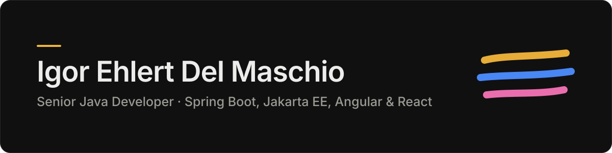

<b>English</b> · <a href="README.pt-BR.md">Português (BR)</a>

  

  

Hi, I'm **Igor**, a Senior Java Developer based in **Jundiaí, SP, Brazil**.

Java developer focused on **Spring Boot**; today I work with **Jakarta EE on Open Liberty**. On the front end, **Angular** and **React** with **TypeScript**, and **Python** when the project needs it.

### Tech stack

**Back-end** 

**Front-end** 

**Data** 

**DevOps & quality** 

**Also** 

### How I work

- **Clear communication:** I explain technical trade-offs to business people and turn business needs into precise tasks.
- **Ownership:** I follow a feature from analysis to deployment, and stay with it until it works in production.
- **Teamwork and code review:** agile teams, honest reviews in both directions, code the whole team can read.
- **Teaching and documenting:** I write guides and help teammates get their environment running.
- **End-to-end debugging:** I chase a bug from the front end through the API to the database until the cause is clear.
- **Fast learner:** Kotlin, WebFlux, Open Liberty, mainframe DB2: each one picked up on the job, on my own.

### Personal projects

Two Windows tools I created and maintain outside work, where I get to explore native code.

| Project | What it is |
|---|---|
| **[Nimbus Menu](https://github.com/igoredm/nimbus-menu)** | Replaces the Windows taskbar with a light dock on every monitor and its own Start menu. In the official Windhawk catalog since Nov 2026. C++ · Win32 · Direct2D/DirectWrite · DWM |
| **[Pitwall](https://github.com/igoredm/pitwall)** | Hardware monitor that shows FPS and sensors on a second monitor, with no overlay and nothing injected into the game. Open source, MIT. C# / .NET 10 · WebView2 · Angular 22 · PresentMon · NVML |

### Experience

| Period | Role | Company |
|---|---|---|
| Aug 2024 — now | Senior Software Developer | Banco do Nordeste (allocated) |
| Aug 2022 — Aug 2024 | Mid-level Software Developer | Kaspper |
| Nov 2020 — Aug 2022 | Software Developer | BluPay (payments fintech) |
| Aug 2020 — Nov 2020 | Junior Java Developer | Kaspper |
| Aug 2019 — Aug 2020 | Software Development Intern | Kaspper |

Currently migrating Java EE microservices from IBM WebSphere to Open Liberty, with REST APIs in JAX-RS and React + TypeScript front-ends.

### Education & highlights

- **B.Sc. in Information Systems**, ESPM · 2017 — 2020
- **Award, Oracle Hackathon at ESPM:** a team-built chatbot that helps students connect with the university.
- **Brazilian Programming Marathon:** regional phase in 2017, 2018 and 2019.
- **Languages:** Portuguese (native), English (intermediate), Spanish (basic).

### Let's talk

A role, a project, or just swapping notes on Windows internals and Java: find me on any of these.

  
  
  
  
  

