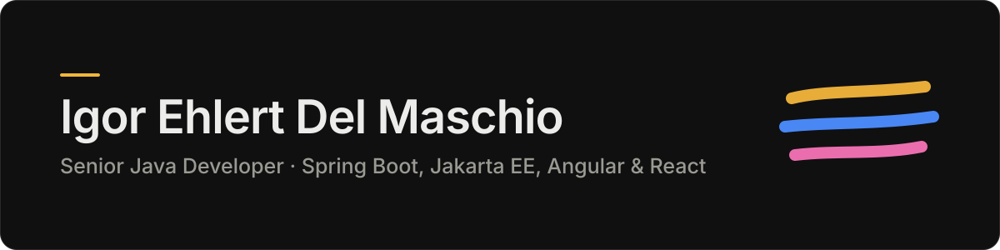
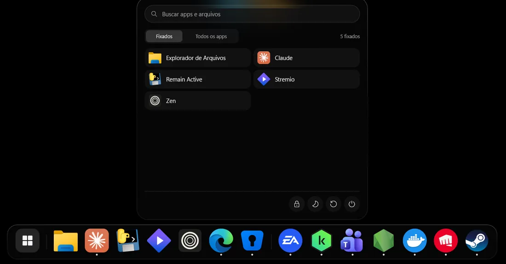
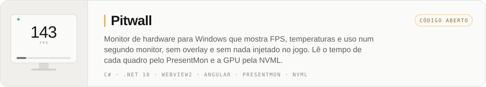
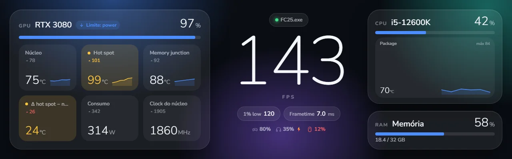

<a href="README.md">English</a> · <b>Português (BR)</b>

  

  

Oi, eu sou o **Igor**, desenvolvedor Full Stack sênior em **Jundiaí, SP**. No trabalho é **Java** (Spring Boot e, hoje, Jakarta EE no Open Liberty) com **Angular** ou **React** no front, e **Python** quando encaixa. Fora dele, faço ferramentas para o Windows.

### Projetos

<a href="https://windhawk.net/mods/nimbus-menu"><picture><source media="(prefers-color-scheme: dark)" srcset="assets/pt/card-nimbus-dark.svg"></picture></a>

<a href="https://windhawk.net/mods/nimbus-menu">Instalar pelo Windhawk</a> · <a href="https://github.com/igoredm/nimbus-menu">Ajuda e sugestões</a>

 

<a href="https://github.com/igoredm/pitwall"><picture><source media="(prefers-color-scheme: dark)" srcset="assets/pt/card-pitwall-dark.svg"></picture></a>

<a href="https://github.com/igoredm/pitwall/releases/latest">Baixar</a> · <a href="https://github.com/igoredm/pitwall">Código-fonte</a>

 

### Stack

**Back-end** 

**Front-end** 

**Dados** 

**DevOps e qualidade** 

**Também** 

### Trabalho

**Hoje:** desenvolvedor Full Stack sênior na Kaspper, alocado no Banco do Nordeste, migrando microsserviços Java EE do WebSphere para o Open Liberty, com front-ends em React e TypeScript. 
**Antes:** BluPay (Kotlin, Spring WebFlux e AWS numa fintech de pagamentos) e a própria Kaspper, onde entrei como estagiário em 2019. 
**Formação:** Sistemas de Informação na ESPM.

Explico decisões técnicas em palavras simples, acompanho a funcionalidade até ela funcionar em produção e escrevo os guias que o próximo vai precisar. Histórico completo em [igoredm.com](https://igoredm.com/?lang=pt) e no [LinkedIn](https://www.linkedin.com/in/igoredm/).

### Vamos conversar

Uma vaga, um projeto ou só trocar ideia sobre Windows por dentro e Java: me chama em qualquer um destes.

  
  
  
  
  

